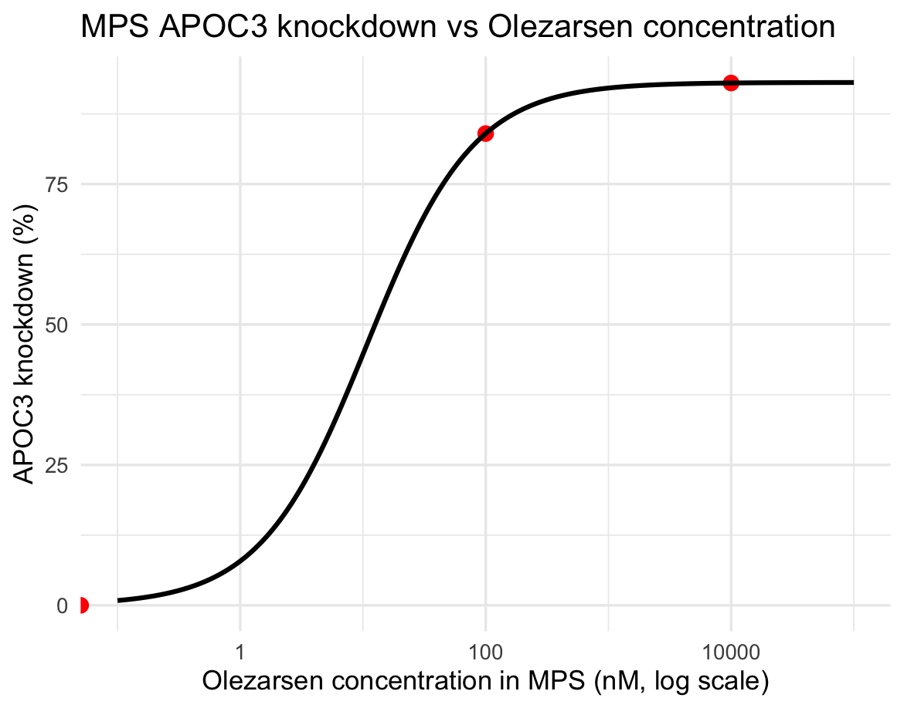
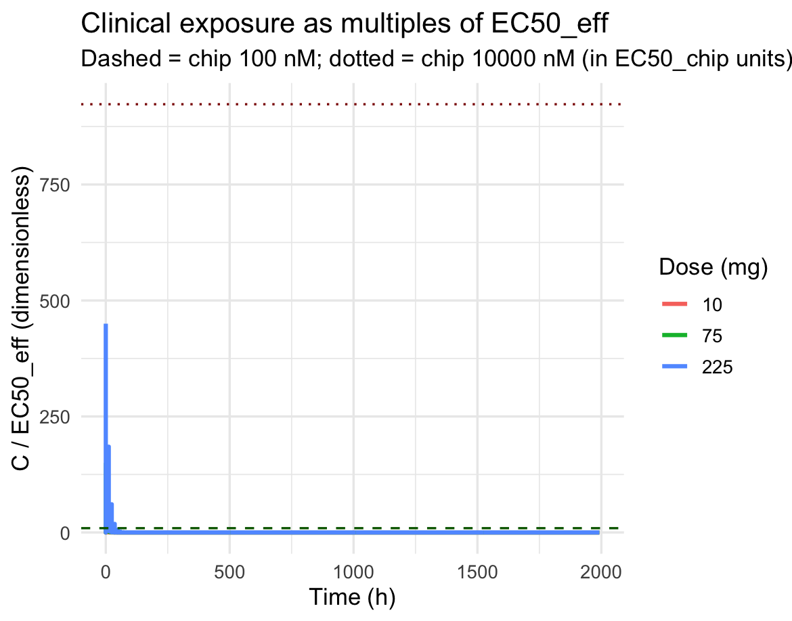
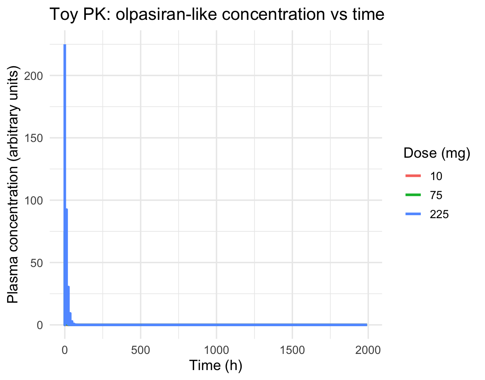
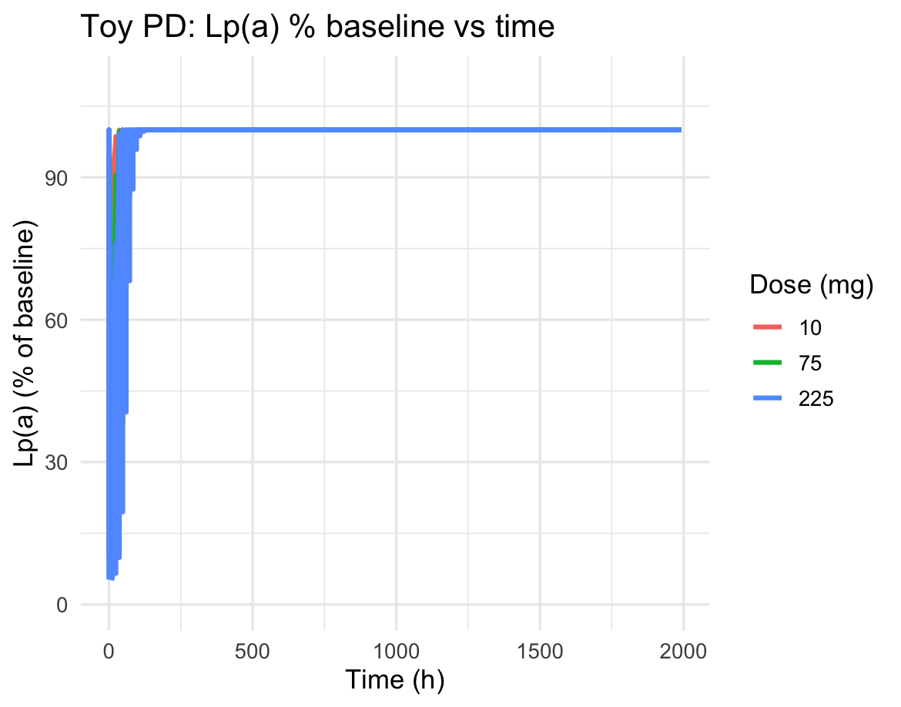

# mps-pkpd-methods

Exploratory translational PK/PD workflows in R linking MPS APOC3 mRNA knockdown summary data to toy clinical-like exposure–response models.

## Contents

- `mps_pkpd_toy_translation.R` — exploratory PK/PD prototype that:
  - Encodes APOC3 knockdown summary data from a PHH+KC MPS system
  - Fits a simple Emax model to MPS knockdown vs concentration
  - Simulates illustrative 1-compartment clinical-like PK profiles
  - Applies an Emax clinical PD link for Lp(a)
  - Compares exposure in EC50-normalized units and summarizes time above EC50 thresholds

## Usage

Install required R packages once:

```r
install.packages(c("PKPDsim", "ggplot2", "dplyr", "minpack.lm"))
```

Then run the script from the repository root:

```bash
Rscript mps_pkpd_toy_translation.R
```

Outputs (CSV and PNG) will be written to:

- `outputs/pkpd_demo/`

## Example figures

| MPS knockdown Emax fit | EC50 comparison |
|---|---|
|  |  |

| Simulated PK profiles | Simulated PD (Lp(a)) profiles |
|---|---|
|  |  |

These are illustrative toy simulations for method development, not clinical predictions.

## License

MIT. See [LICENSE](LICENSE).
